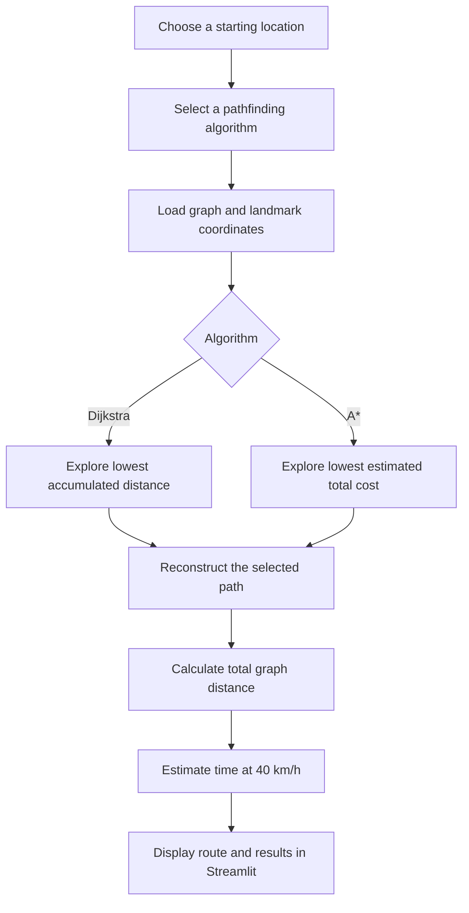

<div align="center">

# 🚌 RouteWise — AI Route Finder to NED University

### *Find your way. Compare the algorithms. Understand the route.*

**An interactive pathfinding experience for navigating to NED University from locations across Karachi.**


**[Explore Features](#-what-you-can-explore) · [How It Works](#-how-route-finding-works) · [Run Locally](#-get-started) · [Algorithms](#-dijkstra-vs-a-search)**

</div>

---

## 🌍 The idea

**What if a university commute could also be a lesson in artificial intelligence?**

Getting from one place to another is a familiar problem. Finding the *best* route is an algorithmic one.

**RouteWise** brings classical AI pathfinding into a recognizable Karachi travel scenario: choose a starting location, set **NED University** as your destination, and explore how **Dijkstra's Algorithm** and **A* Search** find routes across a graph of connected locations.

Rather than treating algorithms as abstract classroom concepts, this project makes their results easier to understand through an interactive **Streamlit** application.

> 🎯 **Project goal:** Demonstrate and compare graph-search algorithms using a landmark-based route-finding example, with estimated distance and travel time.

---

## ✨ What you can explore

| Feature | What it does |
|:--|:--|
| 📍 **Location-based route search** | Finds a route from a selected Karachi location to NED University using the defined graph. |
| 🧭 **Two classic algorithms** | Uses Dijkstra's Algorithm and A* Search for pathfinding. |
| ⚡ **Algorithm comparison** | Lets users explore the route results produced by the two search strategies. |
| 🛣️ **Landmark-by-landmark path** | Displays the sequence of locations along a selected route. |
| 📏 **Distance estimation** | Reports total route distance in kilometers based on the graph's weights. |
| ⏱️ **Travel-time estimation** | Estimates travel time assuming an average speed of **40 km/h**. |
| 🎨 **Interactive Streamlit interface** | Presents search inputs and results in a web-based UI. |
| 🧩 **Modular Python code** | Separates the interface (`app.py`) from graph data and pathfinding logic (`backend.py`). |

---

## 📸 Project showcase

_Add real screenshots from your running application here. This section intentionally avoids broken image links until screenshots are added._

| Route selection | Route results | Algorithm comparison |
|:--:|:--:|:--:|
| 📍 Starting location and algorithm controls | 🛣️ Path, distance, and estimated time | 🧠 Dijkstra vs A* results |

**Suggested screenshot files:** `docs/screenshots/home.png`, `docs/screenshots/route-result.png`, `docs/screenshots/algorithm-comparison.png`.

Once you've uploaded them, replace the descriptions above with GitHub image links such as:

```markdown

```

---

## 🧠 Dijkstra vs A* Search

Both algorithms operate on a **weighted graph**, where intersections or landmarks are represented as **nodes**, connections as **edges**, and edge weights represent travel distance.

| | 🔵 Dijkstra's Algorithm | 🟣 A* Search |
|:--|:--|:--|
| **Search strategy** | Expands the lowest-cost route discovered so far. | Prioritizes estimated total cost to the destination. |
| **Uses a heuristic?** | No. | Yes — Euclidean straight-line distance. |
| **Strength** | Finds shortest paths with non-negative edge weights. | Can explore fewer nodes when the heuristic provides useful guidance. |
| **Optimality** | Finds a shortest path under the non-negative-weight assumption. | Finds a shortest path when the heuristic is admissible and the implementation handles it correctly. |
| **Best takeaway** | A dependable baseline for weighted pathfinding. | A goal-directed approach that can make search more efficient. |

### How does the A* heuristic help?

A* considers two quantities:

- **g(n)** — distance already traveled from the starting node to node `n`.
- **h(n)** — estimated remaining distance from `n` to the destination, using Euclidean distance between coordinates.

Its priority is:

\[
f(n) = g(n) + h(n)
\]

The heuristic estimates closeness to the goal; it is **not** a live traffic prediction. A*'s shortest-path guarantee depends on the heuristic and the graph weights being consistent with the algorithm's assumptions.

---

## 🔄 How route finding works



### Example output

```text
Starting point : Safoora Goth
Destination    : NED University
Route          : Safoora Goth → University Road → NED University
Total distance : Calculated by the application (km)
Estimated time : Calculated from distance at 40 km/h
```

*The route above illustrates the output format; it is not a verified live road itinerary or a measured journey.*

### Travel-time calculation

At the project's assumed average speed:

\[
\text{Estimated time (minutes)} = \frac{\text{Distance (km)}}{40} \times 60
\]

**Note:** This is a simple estimate, not a real-time navigation ETA. Traffic, road closures, signals, and actual vehicle speeds are not reflected unless represented explicitly in the underlying graph.

---

## 🛠️ Tech stack

| Technology | Role in the project |
|:--|:--|
| **Python** | Core application and algorithm implementation |
| **Streamlit** | Interactive web interface |
| **Graph Theory** | Models locations and connections |
| **Dijkstra's Algorithm** | Shortest-path search |
| **A* Search** | Heuristic-guided shortest-path search |
| **Geographic coordinates** | Supports Euclidean-distance estimation for A* |

---

## 📁 Project structure

```text
route-finder-ned/
├── app.py              # Streamlit interface and UI styling
├── backend.py          # Graph data, coordinates, Dijkstra and A*
├── requirements.txt    # Python dependencies
└── README.md           # Project documentation
```

---

## 🚀 Get started

### 1. Clone the repository

```bash
git clone https://github.com/YOUR-USERNAME/YOUR-REPOSITORY.git
cd YOUR-REPOSITORY
```

> Replace the placeholders with the URL and directory name of your actual GitHub repository.

### 2. Create a Python virtual environment (recommended)

**Windows PowerShell:**

```powershell
python -m venv .venv
.\.venv\Scripts\Activate.ps1
```

### 3. Install dependencies

```powershell
python -m pip install -r requirements.txt
```

### 4. Launch the application

```powershell
python -m streamlit run app.py
```

Open the local URL shown in your terminal (typically **http://localhost:8501**).

---

## 🧪 Try a route

1. Launch the Streamlit application.
2. Choose a supported Karachi starting location.
3. Select **Dijkstra** or **A***.
4. Run the route search using the controls provided in the app.
5. Review the resulting landmark sequence, total distance, and estimated travel time.
6. Switch algorithms to compare how they solve the same problem.

**Tip:** Compare the resulting route distance rather than assuming that A* always returns a shorter route. With valid optimality assumptions, both algorithms should be able to find a shortest path; their search strategies differ.

---

## 🎓 What this project demonstrates

This project connects important AI and computer science concepts with an understandable navigation use case:

- **Graph representation:** Modeling real-world connections using nodes and weighted edges.
- **Search algorithms:** Applying Dijkstra and A* to a route-planning problem.
- **Heuristics:** Using geographic distance to guide a goal-directed search.
- **Algorithmic reasoning:** Comparing strategies rather than treating one algorithm as universally better.
- **Application development:** Making algorithm outputs accessible through an interactive Streamlit interface.
- **Modular design:** Keeping presentation separate from pathfinding logic.

---

## ⚠️ Scope and limitations

- Routes depend on the **landmarks, connections, and weights defined in `backend.py`**, not the entire Karachi road network.
- Travel time assumes a constant **40 km/h** and is **not live traffic-aware**.
- Euclidean distance is a heuristic estimate, not necessarily road-travel distance.
- The application is an **educational pathfinding demonstration**, not a replacement for live navigation services.
- Search performance and exact route results depend on the actual graph and implementation; no unverified benchmarks are claimed here.

---

## 🔮 Ideas for future development

- 🗺️ Interactive route maps and landmark visualization.
- 🚦 Traffic-aware edge weights for more realistic journey estimates.
- 📊 Algorithm performance visualization, including explored nodes and execution time.
- 📍 Expanded Karachi location coverage.
- 🛣️ Additional search algorithms for comparative learning.
- 📱 A more mobile-friendly commuter experience.

---

## 👩‍💻 About the developer

**Iqra Nawaz**  
*Data Science & AI Enthusiast*

I enjoy turning concepts from algorithms and data science into practical applications. This project explores how classical AI search techniques can solve a familiar question: **What's a good way to get from here to NED University?**

<div align="center">

**⭐ If you find this project interesting, consider starring the repository!**

*Built with Python, Streamlit, and curiosity about how intelligent search works.* 💜

</div>
